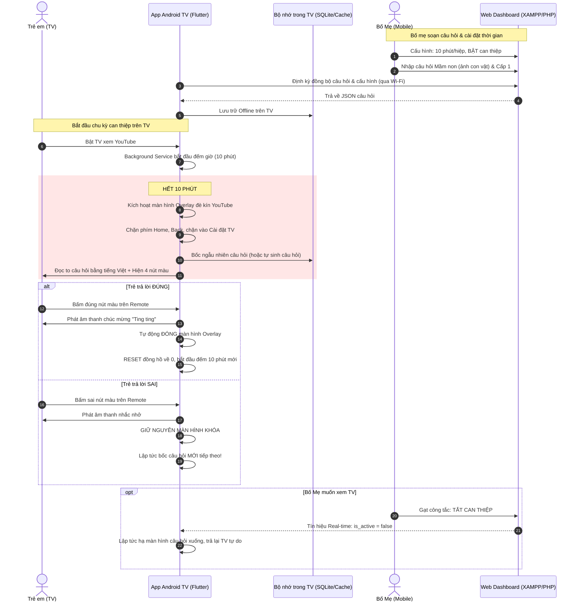

# 🏗️ KIẾN TRÚC HỆ THỐNG - APP CAN THIỆP NHÂN QUẢ

## 1. Luồng vận hành toàn hệ thống (End-to-End Flow)

## 2. Nguyên tắc "Pháo đài" trên Android TV
- Không cung cấp bất kỳ nút thoát hoặc cài đặt nào trên màn hình TV.
- Vô hiệu hóa Accessibility cho màn hình `Settings` của hệ điều hành TV để ngăn trẻ tự gỡ cài đặt.
- Nút `Power` (Nguồn) vẫn hoạt động để trẻ có thể chủ động tắt TV đi ngủ nếu không muốn giải bài.
- 100% chức năng giải đố hoạt động Offline. Mất mạng internet hay rút cáp mạng thì app vẫn hoạt động bình thường nhờ cơ chế tự sinh câu hỏi logic.
